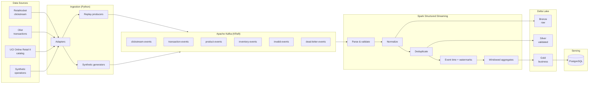

# E-commerce Real-Time Intelligence & Event Streaming Platform

<p align="center">
  
  
  
  
  
  
  
  
</p>

<p align="center">
  <b>Multi-source e-commerce event streaming platform for NovaCart.</b><br/>
  Kafka · Spark Structured Streaming · Delta Lake · Data Quality · PostgreSQL
</p>

---

## Table of contents

- [Overview](#overview)
- [Business problem](#business-problem)
- [Architecture](#architecture)
- [Data sources](#data-sources)
- [Medallion layers](#medallion-layers)
- [Validated results](#validated-results)
- [Tech stack](#tech-stack)
- [Quick start](#quick-start)
- [Documentation](#documentation)
- [Limitations](#limitations)
- [License](#license)

---

## Overview

NovaCart is a fictional mid-sized online marketplace. Its data is fragmented across
independent systems (clickstream, transactions, catalog, inventory) and its
reporting is batch-only, so it cannot see customer behavior or operational
changes in time.

This project builds a **local, reproducible, event-driven data platform** that
integrates multiple independent sources through Apache Kafka, processes them with
Apache Spark Structured Streaming, enforces data quality, persists a three-layer
(Bronze/Silver/Gold) Delta Lake, and serves business-ready metrics through
PostgreSQL.

**Highlights**

- 3 independent data sources + controlled synthetic events.
- Deterministic event IDs for idempotent replay.
- Data quality validation at ingestion and processing boundaries.
- Dead Letter Queue for invalid and poison messages.
- End-to-end streaming validated: 241 raw → 81 deduplicated → 5 Gold metrics.
- 31 automated tests (unit + integration + reliability), all passing.
- Measured throughput: 1,283 events/sec (local, single-node).
- Azure Databricks + ADLS Gen2 documented as target architecture.

---

## Business problem

NovaCart cannot answer questions like *"which products get attention but not
carts?"* or *"which products are trending?"* because behavior, transactions, and
catalog data live in separate systems with no shared identifiers, and reporting
runs nightly.

The platform provides near-real-time visibility into product engagement, demand
signals, transaction activity, and inventory events — without fabricating
relationships between independent datasets.

---

## Architecture



---

## Data sources

| Source | License | Purpose | Key data |
|---|---|---|---|
| Retailrocket | CC BY-NC-SA 4.0 | Clickstream behavior | 2.76M events, 1.4M visitors, 417K items |
| Olist | CC BY-NC-SA 4.0 | Transactions & operations | ~100K orders, 9 tables, 2016–2018 |
| UCI Online Retail II | CC BY 4.0 | Product catalog & transactions | 1.07M rows, 4.6K products, 4.4K customers |
| Synthetic | n/a (labeled) | Inventory, checkout, payments | Controlled generation with provenance |

Retailrocket and Olist identifiers are **never joined** — they are independent
datasets. Cross-source analysis is limited to side-by-side aggregates.

---

## Medallion layers

| Layer | Format | Content | Key property |
|---|---|---|---|
| **Bronze** | Delta | Raw Kafka payloads + ingestion metadata | Append-only, full provenance |
| **Silver** | Delta | Validated, normalized, deduplicated canonical events | Event time + watermark |
| **Gold** | Delta + Postgres | Business aggregates (product engagement) | Serving layer |

---

## Validated results

| Metric | Value |
|---|---|
| Bronze rows (raw) | 241 |
| Silver rows (deduplicated) | 81 |
| Gold rows (product engagement) | 5 |
| Automated tests | 31 (all passing) |
| Producer throughput | 1,283 events/sec |
| Sources integrated | 4 (3 public + synthetic) |

---

## Tech stack

| Component | Technology | Status |
|---|---|---|
| Language | Python 3.12, SQL | Implemented |
| Event backbone | Apache Kafka 3.9 (KRaft) | Implemented |
| Stream processing | Apache Spark 4.2 / PySpark | Implemented |
| Storage | Delta Lake 4.4 | Implemented |
| Serving | PostgreSQL 16 | Implemented |
| Infrastructure | Docker Compose | Implemented |
| Testing | pytest (31 tests) | Implemented |
| CI/CD | GitHub Actions | Implemented |
| Target cloud | Azure Databricks, ADLS Gen2, Azure Monitor | Designed (not implemented) |

---

## Quick start

```bash
# 1. Clone and set up Python
git clone https://github.com/Raf-Hs/ecommerce-realtime-data-platform.git
cd ecommerce-realtime-data-platform
python -m venv .venv && source .venv/bin/activate
pip install -r requirements.txt
cp .env.example .env

# 2. Start infrastructure
docker compose up -d

# 3. Create Kafka topics
python scripts/create_topics.py

# 4. Validate connectivity
python scripts/kafka_smoke_test.py
python scripts/postgres_smoke_test.py

# 5. Run end-to-end validation
python scripts/e2e_streaming_test.py

# 6. Run tests
python -m pytest tests/ -q
```

Java 17+ is required for Spark. See `infrastructure/spark/README.md`.

---

## Documentation

| Document | Description |
|---|---|
| [Business case](docs/business/BUSINESS_CASE.md) | Business context, problem, objectives, metrics |
| [Data sources](docs/data-sources/DATA_SOURCES.md) | Source research, licenses, schemas, limitations |
| [Data dictionary](docs/data-dictionary/DATA_DICTIONARY.md) | Canonical model, field definitions, source mappings |
| [Event catalog](docs/event-schemas/EVENT_CATALOG.md) | Event types, schemas, versions, examples |
| [Architecture](docs/architecture/ARCHITECTURE.md) | System architecture, Mermaid diagrams, data flow |
| [Azure alignment](docs/architecture/AZURE_ALIGNMENT.md) | Azure target architecture, migration strategy |
| [Phase 0 research](docs/PHASE_0_RESEARCH.md) | Full research and architecture (A–J) |
| [Implementation inventory](docs/IMPLEMENTATION_INVENTORY.md) | Audit: implemented / partial / missing |
| [Project status](docs/PROJECT_STATUS.md) | Component and phase progress tracker |
| [Data quality](docs/data-quality/DATA_QUALITY.md) | Validation rules, metrics, DLQ policy |
| [Testing strategy](docs/testing/TESTING_STRATEGY.md) | Test approach, fixtures, CI |
| [Monitoring](docs/MONITORING.md) | Monitoring tools, metrics, visual evidence |
| [E2E validation](docs/E2E_VALIDATION.md) | End-to-end streaming validation results |
| [Pipeline operations](docs/PIPELINE_OPERATIONS.md) | Runbook: start/stop, replay, recovery |
| [Failure recovery](docs/FAILURE_RECOVERY.md) | Failure scenarios and recovery procedures |
| [Limitations](docs/LIMITATIONS.md) | Known limitations and scope boundaries |
| [Performance benchmarks](docs/benchmarks/PERFORMANCE_BENCHMARKS.md) | Measured throughput, latency, lag |
| [Contributing](docs/CONTRIBUTING.md) | Dev setup, conventions, commit style |
| [Decisions (ADRs)](docs/decisions/) | 10 Architecture Decision Records |

---

## Limitations

- Single-node execution; not representative of production scale.
- Retailrocket values are hashed (opaque IDs).
- Sources are independent — no cross-source joins.
- Synthetic data is simulated and labeled.
- Azure components designed only; no paid resources created.
- Gold streaming requires a second micro-batch to emit (watermark semantics).

---

## License

Project code: MIT. Datasets retain their own licenses;
see [Data sources](docs/data-sources/DATA_SOURCES.md).