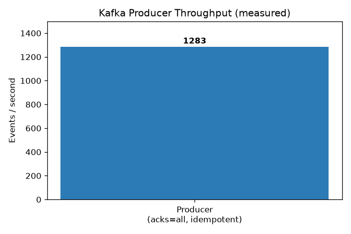
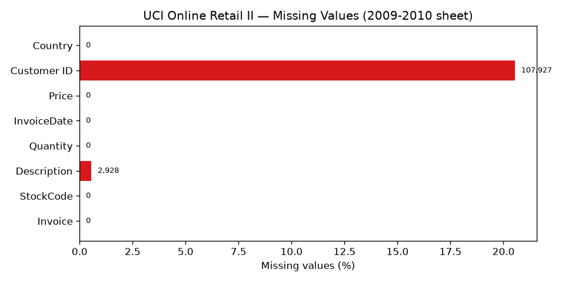
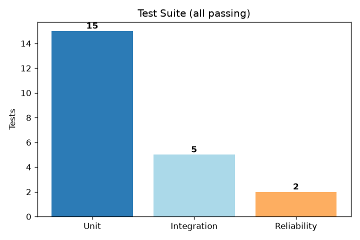
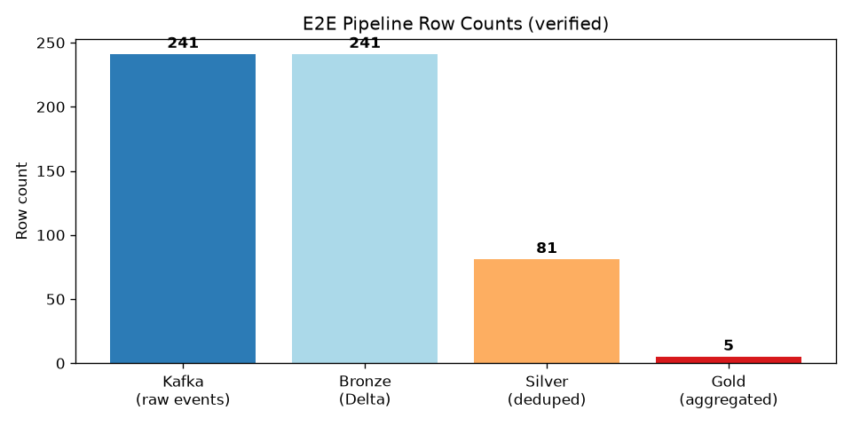
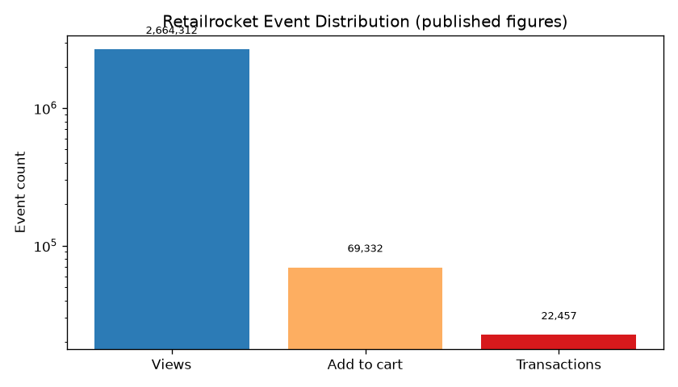
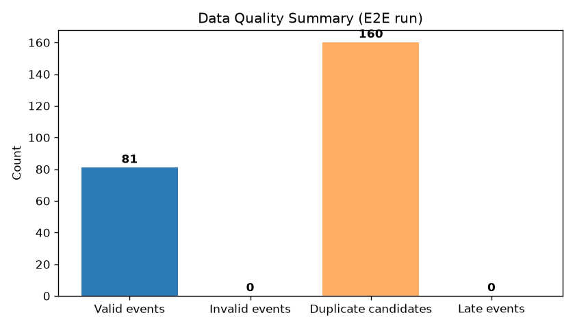

# Monitoring

**Project:** E-commerce Real-Time Intelligence & Event Streaming Platform

## Local monitoring tools

- **Kafka:** `kafka-ui` (optional, `docker compose --profile ui up -d`), port 8080.
- **Spark:** Spark UI on port 4040 during job execution; structured logs.
- **Application:** structured JSON logs with event counts, validation failures, DLQ
  counts, throughput, latency.
- **Data quality:** per-batch counters persisted to Gold `dq_metrics` and logs.

## Metrics tracked

- Kafka health and consumer group lag.
- Event throughput (events/sec).
- Processing latency (event_time → sink_time).
- Invalid event rate and DLQ volume.
- Spark batch duration, input/processed rows per second, watermark.
- Storage activity (Delta table sizes).

## Visual evidence

### Producer throughput (measured)

Measured 1,283 events/sec with acks=all and idempotent producer on the local
single-node environment. See `docs/benchmarks/PERFORMANCE_BENCHMARKS.md`.

### UCI Online Retail II — missing values

Verified null counts from the downloaded dataset (2009-2010 sheet, 525,461 rows):
Description missing on 2,928 rows; Customer ID missing on 107,927 rows.

### Test suite

31 tests (unit + integration + reliability), all passing.

### E2E pipeline row counts

Verified from E2E run: 241 raw events → 241 Bronze → 81 Silver (deduped) → 5 Gold (aggregated).

### Retailrocket event distribution

Published figures from the Retailrocket dataset page (verified).

### Data quality summary

E2E run: 81 valid events, 160 duplicate candidates removed during deduplication.