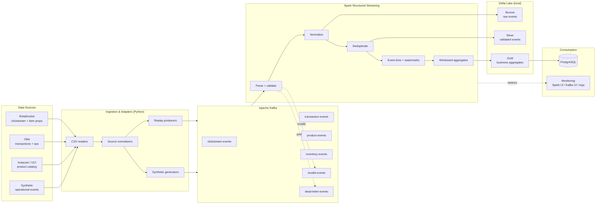
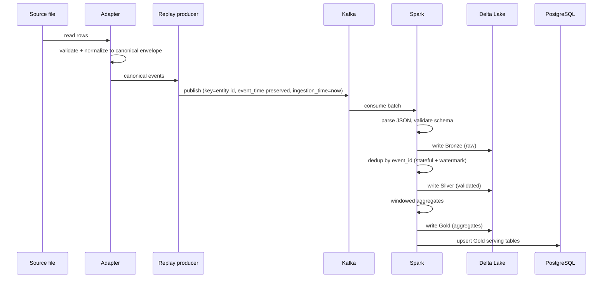
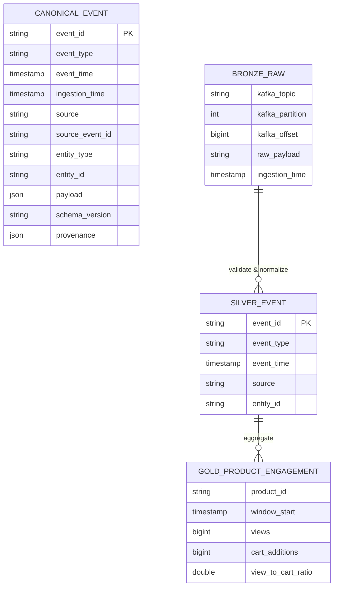
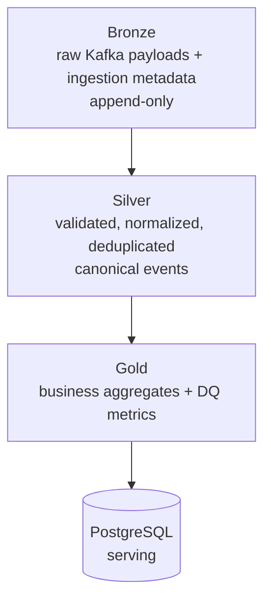

# Architecture

**Project:** E-commerce Real-Time Intelligence & Event Streaming Platform

## 1. Overview

NovaCart's platform is a local-first, event-driven data platform. It ingests events
from multiple independent sources through Apache Kafka, processes them with Apache
Spark Structured Streaming, enforces data quality, persists a three-layer
(Bronze/Silver/Gold) Delta Lake, and serves business-ready metrics through
PostgreSQL. The design is portable to Azure (Databricks + ADLS Gen2) without
structural change.

Status legend used throughout:
- **Implemented (local)** — running code/config in the repo.
- **Designed** — specified, not yet implemented.
- **Proposed** — future, not committed.

## 2. System architecture

## 3. Data flow

## 4. Canonical data model

Identifiers are source-prefixed (`rr:`, `olist:`, `syn:`) and are never joined
across sources.

## 5. Kafka topic strategy

| Topic | Domain | Key | Partitions (initial) | Retention |
|---|---|---|---|---|
| `clickstream-events` | Retailrocket behavior | `itemid` | 6 | 7 days |
| `transaction-events` | Olist orders/payments | `order_id` | 6 | 14 days |
| `product-events` | Catalog updates | `product_id` | 3 | 14 days |
| `inventory-events` | Synthetic stock | `product_id` | 3 | 7 days |
| `invalid-events` | Schema-invalid | `source` | 3 | 30 days |
| `dead-letter-events` | Poison messages | `source` | 3 | 30 days |

## 6. Data Lakehouse layers (Delta Lake)

- **Format:** Delta Lake (open source; Parquet + transaction log). Runs locally via
  `delta-spark`; designed to port to ADLS Gen2 + Databricks without code change.
- **Partitioning:** by `source` and date.
- **Schema evolution:** supported by Delta; controlled via schema version field.

## 7. Azure alignment (designed, not implemented)

| Layer | Local (implemented/planned) | Azure target (designed) | Status |
|---|---|---|---|
| Processing runtime | Apache Spark (local) | Azure Databricks | Designed |
| Storage | Delta Lake on local FS | ADLS Gen2 + Delta | Designed |
| Orchestration | Docker Compose + scripts | Azure Data Factory (batch only) | Proposed |
| Monitoring | Spark UI, Kafka UI, logs | Azure Monitor | Designed |
| Secrets | `.env` (local) | Azure Key Vault | Proposed |

No paid Azure resources are created. All Azure items are documented as target
architecture only.

## 8. Monitoring strategy

- **Kafka:** broker health, topic/partition counts, consumer group lag.
- **Spark:** query progress, batch duration, input/processed rows per second,
  state store size, watermark.
- **Application:** structured JSON logs with event counts, validation failures,
  DLQ counts, throughput, latency.
- **Data quality:** per-batch counters persisted to Gold (`dq_metrics`) and logs.

## 9. Technology stack

See `docs/PHASE_0_RESEARCH.md` section F and `README.md`. Core: Python, SQL,
PostgreSQL, Kafka, Spark/PySpark, Delta Lake, Docker Compose, pytest, GitHub
Actions. Azure components are target architecture only.